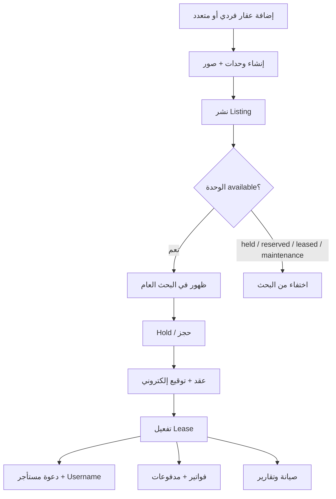
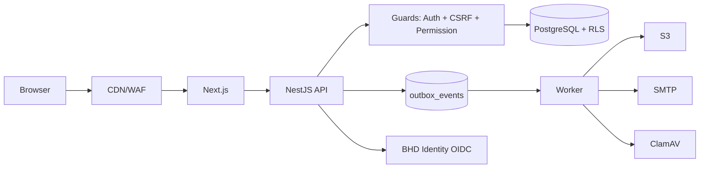

# توثيق مشروع BHD R — إدارة العقارات

**الإصدار:** 0.1.6

**التاريخ:** 24 أغسطس 2026

**المستودع المستهدف:** [ainoamn/BHD-R](https://github.com/ainoamn/BHD-R)

**النطاق المقترح:** `r.bhd-om.com`

**عميل الهوية:** `bhd-r`

**مسار SSO:** `/api/auth/bhd/start|callback|logout` · `admin-entry` — راجع [`BHD-R-SSO-COMPLIANCE.md`](./BHD-R-SSO-COMPLIANCE.md)

هذه الوثيقة هي المرجع الشامل للمنتج: ماذا يفعل، كيف يعمل، بنيته، وحداته، أمنه، وتشغيله. للتفاصيل التشغيلية راجع الفهرس في [`docs/README.md`](./README.md).

---

## 1. الخلاصة التنفيذية

**BHD R** منصة عمانية ثنائية اللغة (عربي / إنجليزي) لإدارة وتسويق العقارات والوحدات، العقود الإلكترونية، الفواتير والمدفوعات، الصيانة، والتقارير. الحرف **R** يعني **Real Estate Management — إدارة العقارات**.

بُنيت من الصفر كـ **Modular Monolith** داخل Monorepo، بهوية BHD الموحدة، دون دمج شيفرة النظام القديم `bhd-om`. الهدف: نفس السلوك التشغيلي المطلوب (عقار ← وحدة ← نشر ← حجز ← عقد ← توقيع ← إيجار ← فاتورة ← دفع ← صيانة)، بتقنيات أخف وأأمن وأوضح.

| البعد    | القرار                                                                              |
| -------- | ----------------------------------------------------------------------------------- |
| المنتج   | منصة عقارية متعددة الأدوار مع سوق عام                                               |
| الهوية   | BHD Identity OIDC (`bhd-r`) عبر `/api/auth/bhd/*` + جلسات Host-only `bhd_r_session` |
| الواجهة  | Next.js 16 + React 19 + Tailwind 4 + next-intl                                      |
| الـ API  | NestJS 11 على Fastify                                                               |
| البيانات | PostgreSQL 17 + PostGIS + Drizzle + RLS                                             |
| الخلفية  | Worker + Redis/BullMQ + Outbox                                                      |
| الوسائط  | S3 خاص للأصل + مشتقات عامة بعلامة مائية                                             |
| المال    | NUMERIC / Decimal — لا Float                                                        |
| اللغات   | ar (RTL) و en (LTR)                                                                 |
| العملات  | OMR, BHD, KWD, AED, SAR, QAR, USD + قابلية إضافة                                    |

---

## 2. أهداف المنتج

1. تمكين إدارة المنصة والمالك والمطور من إدارة محفظة عقارية منظمة.
2. عرض الوحدات المتاحة فقط للجمهور بعد اكتمال النشر والتوفر.
3. إدارة دورة الإيجار حتى التوقيع الإلكتروني والفوترة والتحصيل.
4. منح المستأجر بوابة مستقلة لعقوده وفواتيره وطلبات الصيانة.
5. عزل المؤسسات (tenants) بصلاحيات مركزية وRLS.
6. التوافق مع هوية ومنتجات BHD الأخرى (ألوان، دخول موحد، أسلوب تشغيل).
7. قابلية التوسع الخليجي والدولي عبر Country Packs.

---

## 3. من يستخدم النظام؟ (الأدوار واللوحات)

| اللوحة       | المسار النموذجي              | من يستخدمها       | ماذا ترى                                       |
| ------------ | ---------------------------- | ----------------- | ---------------------------------------------- |
| المنصة       | `/platform`                  | إدارة BHD R       | المؤسسات، الباقات، التدقيق، CMS، الدعم         |
| المالك       | `/owner`                     | فرد أو شركة مالكة | العقارات، العقود، الفواتير، الممثلين، التقارير |
| المطور       | `/developer`                 | مطور عقاري        | المشاريع، الوحدات، النشر، التحصيل              |
| المستأجر     | `/tenant`                    | مستأجر مفعّل      | عقوده، فواتيره، دفعاته، الصيانة                |
| الموقع العام | `/`, `/properties`, `/units` | الزائر            | الوحدات المتاحة فقط                            |

**قاعدة ذهبية:** الأدوار منفصلة؛ لا دور يرث الآخر ضمنياً. كل مستخدم يرى ما له فقط عبر permission registry + resource grants + organization context.

صلاحيات قابلة للاختبار (54): انظر `packages/authz` و[`product/phase-0/03-access-control-model.md`](./product/phase-0/03-access-control-model.md).

أدوار النظام الأساسية:

- `platform_admin`, `platform_support`
- `organization_owner`, `organization_admin`, `property_manager`
- `finance_manager`, `maintenance_agent`, `developer_admin`
- `tenant`, `auditor`

---

## 4. كيف يعمل البرنامج؟ (رحلة من طرف لطرف)



### 4.1 إضافة العقار

1. من لوحة المالك أو المطور أو المنصة يفتح معالج العقار (`property-wizard`).
2. يختار **فردي** (`single_unit`) أو **متعدد الوحدات** (`multi_unit`).
3. الفردي ينشئ وحدة واحدة تلقائياً؛ المتعدد يدخل تفاصيل كل وحدة (مساحة، غرف، إيجار، مرافق…).
4. تُرفع الصور عبر upload intent إلى التخزين الخاص، ثم يعالجها Worker (إعادة ترميز، إزالة EXIF، علامة مائية، AVIF/WebP).
5. لا يكفي زر النشر: الظهور العام يتطلب اكتمال البيانات + حالة توفر مشتقة `available`.

#### صفحة إدارة العقار (0.4.97)

صفحة العقار في لوحة المالك/المطوّر (`/owner/properties/[id]`) مرتبة من الأعلى للأسفل:

1. **شريط «إجراءات هذا العقار»**: ثابت دائماً في الأعلى أثناء التمرير. فيه: الرجوع للمحفظة، تعديل العقار، عرض للجمهور، الإقامة اليومية، الحجوزات، العقود، الشروط والأحكام، التأجير، البيع، الصيانة، الفواتير، الحسابات.
2. **بطاقة العقار**: صورة الغلاف، الحالة، النوع، الرقم المتسلسل، العنوان، المالك، العربون، المساحة، سنة البناء.
3. **أرقام سريعة**: الوحدات والمنشورة منها، الإقامات النشطة، العقود، الصور.
4. **الحجوزات اليومية، والعقود والإيجارات، والوحدات** (السعر، حالة النشر، الإشغال)، وبجانبها «يحتاج انتباهك» والمالية.
5. **إجراءات حساسة** في الأسفل: أرشفة/استعادة وحذف نهائي.

التفاصيل: [implementation/RELEASE-0.4.97-AR.md](./implementation/RELEASE-0.4.97-AR.md).

#### عرض العقارات وإدارة العقارات (0.5.7)

- «العقارات» في الشريط الجانبي قائمة منسدلة بخيارين: **عرض العقارات** (`/{portal}/properties`) و**إدارة العقارات** (`/{portal}/properties?mode=manage`).
- **العرض:** القائمة بلا عمود إجراءات وبلا أزرار في الصفوف.
- **الإدارة:** زر «إدارة العقار» أو «إدارة الوحدة» لكل صف يفتح صفحة إدارة العقار، وسهم الرجوع فيها يعيد إلى «إدارة العقارات».
- صفحات العقار الفردي تُحسب ضمن «إدارة العقارات» في الشريط الجانبي، ومعالج الإضافة ضمن «عرض العقارات».
- التفاصيل: [implementation/RELEASE-0.5.7-AR.md](./implementation/RELEASE-0.5.7-AR.md).

#### أقسام العقار داخل صفحة العقار (0.5.8)

- أزرار «الحجوزات والمعاينات»، «العقود»، «التأجير»، «البيع»، «الصيانة»، «الفواتير»، «الحسابات» في شريط إجراءات العقار تعرض القسم **داخل صفحة العقار** (`/{portal}/properties/[id]?section=<القسم>`) بدل الانتقال لصفحة القسم العامة.
- القسم يُعرض بلوحة العمليات نفسها مقيّدة بالعقار (`scopePropertyId` و`scopeUnitIds`): السجلات والمؤشرات وطوابير العمل وقوائم نموذج الإضافة لهذا العقار ووحداته فقط.
- اسم العقار في الشريط يعيد إلى النظرة العامة.
- الفواتير (عبر العقد ثم الوحدة) والصيانة (عبر الوحدة) والمصروفات تحمل الآن `propertyId` و`unitId` في بيانات Neon.
- التفاصيل: [implementation/RELEASE-0.5.8-AR.md](./implementation/RELEASE-0.5.8-AR.md).

#### بيانات أقسام العقار من قاعدة البيانات (0.5.9)

- حلّ محل لوحة العمليات المقيّدة في 0.5.8: كل قسم يُقرأ من Neon لهذا العقار فقط عبر `GET /api/portal/property-records/:propertyId/:section` (`property-records-neon.ts`)، ضمن سياق المؤسسة وRLS، مع التحقق من ملكية العقار.
- يعرض `PropertySectionRecords` جدولاً خاصاً بكل قسم: العقود بكل حالاتها مع المستأجر وتواريخ الإيجار وحالة الإيجار، والتأجير مع التأمين وتاريخ الإلغاء، والفواتير مع المدفوع والمتبقي، والحسابات (إيرادات الإقامة والإيجار ومصروفات العقار).
- تصفية بالحالة، وبحث، وملخص مالي للفواتير والحسابات، وزر «فتح» للعقد أو الحجز.
- «الشروط والأحكام» صفحة خاصة بالعقار كما هي (شروط مخصّصة أو الصيغة الموحدة للمؤسسة).
- التفاصيل: [implementation/RELEASE-0.5.9-AR.md](./implementation/RELEASE-0.5.9-AR.md).

#### اعتماد الحجز → العقد → التأجير، والعقود اليدوية (0.6.0)

- **الحجوزات:** «اعتماد الحجز» لطلبات `request_pending` يعيد فحص التواريخ، ويُنشئ قفل الحجز، ويجعل الحجز «مؤكّد». ثم يُنشئ عقد إيجار `CTR-YYYY-NNNNNN` وإيجاراً لفترة الحجز. «رفض» يلغي الطلب ويحرّر التواريخ.
- **التوقيع:**
  - توقيع المستأجر يأتي من قبوله للشروط والأحكام عند الحجز.
  - توقيع المالك يضعه النظام باسم المستخدم إن كان يملك `contract.sign`. وإلا يصبح العقد «بانتظار اعتماد المدير» مع طلب اعتماد مُسنَد لمالك المؤسسة، ويعتمده المالك بزر «اعتماد العقد».
- **التأجير:** حالة «مؤجر / يبدأ لاحقاً / انتهت المدة»، ورقم العقد رابط إلى قسم العقود.
- **العقود اليدوية:** «عقد تأجير يدوي» في قسم التأجير (يمنع تداخل الإيجارات)، و«عقد بيع يدوي» في قسم البيع (صفقة بيع وعقد مرتبط).
- **المسار:** `POST /api/owner/properties/:propertyId/records` (`property-contracts-neon.ts`).
- التفاصيل: [implementation/RELEASE-0.6.0-AR.md](./implementation/RELEASE-0.6.0-AR.md).

#### تسجيل عقد الإيجار بشروطه المالية (0.6.1)

- **النموذج:** «+ عقد تأجير يدوي» في قسم التأجير، بأقسام bhd-om: بيانات العقد، المستأجر (فرد أو شركة، أو من دفتر العناوين)، الوحدة والعدادات، الإيجار والمدة، الضرائب والرسوم، التأمين، جدول الدفع، والمبالغ الإضافية والخصومات.
- **الحساب** (`lease-terms.ts`، مشترك بين المتصفح والخادم):
  - الإيجارات من الجدول، والأيام الزائدة بالتناسب.
  - القيمة المضافة 5% مع الإيجار أو بشيكات منفصلة.
  - البلدية 3% من الإيجارات، ورسوم التسجيل، وضريبة أخرى اختيارية.
  - الإضافات والخصومات بحسب التكرار والمدة، وخصم فترة السماح (الإيجار ÷ 30 × الأيام).
  - التأمين منفصل عن إجمالي العقد.
- **الحفظ:**
  - الشروط كاملة في `payloadSnapshot.leaseTerms`، وبيانات المستأجر في `payloadSnapshot.tenantDetails`.
  - الإيجار الشهري ويوم الاستحقاق في `leases`.
  - الشيكات في `cheques` بحالة «بانتظار المراجعة».
- **العرض:** عمود «إجمالي العقد» في التأجير، وزر «التفاصيل المالية» في التأجير والعقود.
- التفاصيل: [implementation/RELEASE-0.6.1-AR.md](./implementation/RELEASE-0.6.1-AR.md). المرجع الدائم (الحقول، شكل الطلب، ما يُحفظ، الأخطاء): [implementation/LEASE-REGISTRATION-AR.md](./implementation/LEASE-REGISTRATION-AR.md).

#### أولوية الحجوزات وتنبيهات الاعتماد (0.6.2)

- **صفحة الحجوزات:** الترتيب بالأولوية (`booking-priority.ts`): بانتظار الاعتماد، ثم يحتاج إجراءً، ثم مقيم الآن، ثم قادم (الأقرب أولاً)، ثم منتهٍ، ثم ملغى (الأحدث أولاً). الصفوف المنتظرة مميَّزة، وشريط بعددها.
- **الألوان:** برتقالي للاعتماد، كهرماني للانتظار، أخضر للمؤكد، أزرق للمجدول، رمادي للمنتهي، أحمر للملغى.
- **الشاشة الرئيسية:** تنبيها «عقد بانتظار اعتمادك» و«طلب حجز بانتظار الاعتماد»، وقائمة «بانتظار اعتمادك» تفتح العقد (`?section=contracts&focus=`) أو قسم الحجوزات في صفحة العقار.
- **رأس البوابة:** جرس بعدد البنود (`PortalApprovalsBell`)، يقرأ `GET /api/portal/pending-approvals` ويتحدّث بعد أي اعتماد.
- **الصلاحيات:** العقود لمن يملك `contract.sign`، وطلبات الحجز لمن يملك `stay.booking.manage` و`contract.create`. المالك يرى عقاراته فقط.
- التفاصيل: [implementation/RELEASE-0.6.2-AR.md](./implementation/RELEASE-0.6.2-AR.md).

#### المؤشرات المطوية والإحصائيات المضغوطة (0.6.5)

- **الحجوزات:** «المؤشرات ومراحل العمل» تبدأ مطوية كقائمة منسدلة (عرض/طي بسهم)، ويُحفظ الاختيار في `sessionStorage` لكل صفحة.
- **شكل موحّد للإحصائيات:**
  - بطاقات الأرقام `ops-metrics`: الرقم بجانب العنوان، بلون المعنى (إجمالي، متابعة، مكتمل، مميّز).
  - مراحل العمل `ops-flow`: شرائح، والمرحلة التي فيها سجلات بصنف `is-active`.
  - `dash-metric` و`pmh-stats` و`psr-summary` بأحجام أصغر.
- التفاصيل: [implementation/RELEASE-0.6.5-AR.md](./implementation/RELEASE-0.6.5-AR.md).

#### الوحدات الشاغرة المطوية والنوافذ على كامل الشاشة (0.6.6)

- **الوحدات الشاغرة:** قسم «وحدات شاغرة — إجراءات سريعة» عنصر `<details>` مطوي افتراضياً، فيه عدد الوحدات وسهم، وقائمة الوحدات المفتوحة لها تمرير داخلي.
- **النوافذ المنبثقة:**
  - كل نوافذ لوحة العمليات تُعرض عبر `ModalPortal` داخل `<body>`، فلا تحبسها حاويات الصفحة المتحركة.
  - تمنع تمرير الصفحة خلفها.
  - تملأ الشاشة على الجوال والتابلت.
  - الرأس والأزرار ثابتة.
- التفاصيل: [implementation/RELEASE-0.6.6-AR.md](./implementation/RELEASE-0.6.6-AR.md).

#### إلغاء الحجز وتعديل تواريخه من صفحة الضيف (0.6.7)

- **الإلغاء:** نافذة تأكيد بتنبيه أن المبلغ المدفوع قد لا يُسترد بحسب سياسة الإلغاء لدى المؤجر.
- **تعديل التواريخ:** يعدّل الحجز نفسه، فيبقى رقمه وحالته.
  - التقويم يعرض الأيام الشاغرة فقط، مع أيام الحجز الحالي.
  - السعر هو سعر التقويم.
- **قاعدة السعر (`stayRescheduleCharge`):**
  - المبلغ المعتمد = الأعلى بين سعر التقويم للتواريخ الجديدة وسعر الحجز الأصلي.
  - فرق العرض أو السعر الأرخص لا يُسترد.
  - الحجز المدفوع لا يُعدَّل إلى سعر أعلى إلكترونياً.
- **الخادم:** `POST /api/public/stays/guest/reschedule`، بمعاينة (`confirm: false`) ثم تأكيد ينقل القفل ويسجّل التعديل.
- التفاصيل: [implementation/RELEASE-0.6.7-AR.md](./implementation/RELEASE-0.6.7-AR.md).

#### سرعة لوحة تحكم المالك — المرحلة الأولى (0.6.8)

- **إعدادات الجلسة:** كل معاملة ترسل إعدادات أمان الصفوف (`app.organization_id` وغيرها) بأمر `select set_config(...)` واحد عبر `applySessionSettings`.
- **التوازي:** النظرة العامة وقائمة الاعتمادات وأقسام العمليات وتفاصيل العقار تُرسل استعلاماتها المستقلة معاً.
- **بيانات النماذج:** تُحمَّل مع القائمة، وتُحفظ 20 ثانية لكل مستخدم، وتُمسح عند فتح الحجوزات والتأجير.
- **المتصفح:** لوحة كل قسم تُركَّب عند أول زيارة، وبياناتها مسخّنة مسبقاً.
- التفاصيل: [implementation/RELEASE-0.6.8-AR.md](./implementation/RELEASE-0.6.8-AR.md).

#### قراءة كل أقسام اللوحة من Neon، وفهارس القراءة (0.6.9)

- **الأقسام:** الطلبات، الحجوزات، التأجير، المبيعات، العقود، المدفوعات، المحاسبة، أوامر العمل، المهام، المحاماة، التقارير، والفريق تُقرأ من Neon عبر `loadOpsSectionFromNeon`. Nest احتياط عند الفشل فقط.
- **الأمان:** شرط `organization_id` في كل استعلام، لأن دور الموقع يتجاوز أمان الصفوف. والصلاحيات تُفحص كما في Nest.
- **النماذج:** سياق Neon يشمل المستخدمين والموردين والتذاكر وعقود الإيجار والفواتير والقوالب والحجوزات والحسابات.
- **الفهارس:** `custom/0026_portal_read_indexes.sql` (تسعة فهارس، مطبّقة على الإنتاج).
- التفاصيل: [implementation/RELEASE-0.6.9-AR.md](./implementation/RELEASE-0.6.9-AR.md).

#### تصميم هادئ موحّد للوحة التحكم (0.7.0)

- **طبقة واحدة:** قسم «Portal calm design» في آخر `globals.css`، ومحدداته تبدأ بـ `.portal-layout` أو `.ops-modal`، فلا تمس الموقع العام.
- **الألوان:** متغيرات `--calm-*`: خلفية `#f4f6f5`، وأسطح بيضاء، ولون رئيسي `#0f5b4a`، ولمسة ذهبية `#a07a45`.
- **الهيكل:** قائمة جانبية بيضاء والصفحة الحالية بخلفية خضراء ناعمة، ورؤوس الأقسام بطاقات بيضاء بلا الشريط الملوّن، ومؤشرات محايدة بنقطة أو حد لوني هادئ.
- **النماذج والنوافذ:** حقول بحدود رمادية وحلقة تركيز خضراء (حالات التحقق تبقى كما هي)، ونوافذ بخلفية أخف.
- التفاصيل: [implementation/RELEASE-0.7.0-AR.md](./implementation/RELEASE-0.7.0-AR.md).

#### تسجيل دخول ومغادرة ضيف الإقامة (0.7.1)

- **المراحل:** مؤكّد ← «بانتظار الدخول» ← (تسجيل الدخول) «بانتظار المغادرة» ← (تسجيل المغادرة) «تم المغادرة»، من تبويب الحجوزات في صفحة العقار.
- **البيانات:** وقت الدخول أو المغادرة الفعلي وملاحظاته واسم من سجّله في `metadata_json` لسجل حالات الحجز (`lib/stay-arrival-neon.ts`).
- **الضيف:** يرى الوقتين والملاحظات في مراحل الحجز وتفاصيله.
- **صفحة واحدة:** `/stays/booking/confirmed` يحوّل إلى `/guest/stays/[id]` مع رسالة ترحيب وزر توقيع العقد.
- التفاصيل: [implementation/RELEASE-0.7.1-AR.md](./implementation/RELEASE-0.7.1-AR.md).

#### المزامنة الحية بين الحسابات (0.7.2)

- **الفكرة:** كل كتابة في قاعدة البيانات (من الموقع أو Nest أو العامل) تضيف رقماً متزايداً في `live_changes` عبر مشغّلات، لكل منظمة ولكل حجز إقامة.
- **المتصفح:** `LiveSync` يسأل `GET /api/live/pulse` كل 3 ثوانٍ والتبويب ظاهر؛ عند تغيّر الرقم يعيد جلب البيانات بصمت ويحدّث مكونات الخادم، دون وميض أو فقد لما في النماذج.
- **الضيف:** صفحة الحجز تتابع حجزها وحده عبر المعرّف ورمز الحجز، وتقرأ من Neon مباشرة.
- **الجلسة:** لا تحديث عند التركيز أو عودة التبويب؛ التحديث فقط عند تغيّر البيانات فعلاً.
- التفاصيل: [implementation/RELEASE-0.7.2-AR.md](./implementation/RELEASE-0.7.2-AR.md).

#### صفحة العقد وإدخال الوقت يدوياً (0.7.3)

- **صفحة العقد:** تُقرأ من Neon مباشرة (بصلاحية `contract.read` وشرط المنظمة والطرف)، وNest بديل؛ لا تسقط إن كان Nest نائماً.
- **وقت الدخول والمغادرة:** يُكتب باليد: تاريخ يوم/شهر/سنة ووقت ساعة:دقيقة مع ص/م، بأرقام عربية أو لاتينية، مع أزرار «الآن / قبل ساعة / أمس» وسطر يؤكد ما سيُسجَّل بتوقيت مسقط.
- التفاصيل: [implementation/RELEASE-0.7.3-AR.md](./implementation/RELEASE-0.7.3-AR.md).

#### رسالة الضيف حسب مرحلة الحجز (0.7.4)

- **الفكرة:** بطاقة ترحيب باسم الضيف أعلى صفحة إقامته تتبدّل مع الحالة: ترحيب وإرشاد عند تقديم الطلب، ثم «قيد الفحص والتدقيق من المالك أو ممثليه»، ثم بشارة الاعتماد، ثم «إقامة ممتعة» عند الوصول، ثم شكر ودعوة للعودة عند المغادرة.
- **الأسلوب:** حفاوة ورحابة مع لمسة دعابة، بالعربية والإنجليزية؛ كل النصوص في `lib/stay-guest-greeting.ts`.
- التفاصيل: [implementation/RELEASE-0.7.4-AR.md](./implementation/RELEASE-0.7.4-AR.md).

#### مراحل الحجز التفاعلية (0.7.5)

- **الفكرة:** شريط المراحل في صفحة الضيف صار أزراراً؛ كل مرحلة وصلها الضيف تعرض شاشتها كما ظهرت له (الترحيب، المراجعة أو الموافقة، الوصول، الوداع)، والمراحل القادمة مقفلة.
- **العودة:** شريط «هكذا ظهرت مرحلة …» مع زر «العودة إلى الآن».
- التفاصيل: [implementation/RELEASE-0.7.5-AR.md](./implementation/RELEASE-0.7.5-AR.md).

#### العقد كأصل المستند (0.7.6)

- **الفكرة:** صفحة العقد ورقة كاملة بترويسة الشركة: الأطراف، محل العقد، المدة والقيمة، الاستلام والتسليم، نص العقد، الشروط المقبولة، التواقيع بصورها وبصماتها، المرفقات، الملاحق، وسجل العقد.
- **الأدوات:** طباعة الوثيقة وحدها، تصدير PDF من نافذة الطباعة، مشاركة الرابط، وإرسال ملخص ورابط إلى الطرف الآخر بالبريد أو واتساب.
- **الخصوصية:** صور الهوية والصورة الشخصية عبر مسار محمي، لمدير الحجوزات أو المستأجر نفسه فقط.
- التفاصيل: [implementation/RELEASE-0.7.6-AR.md](./implementation/RELEASE-0.7.6-AR.md).

#### عبارات صفحة الضيف (0.7.7)

- **الأسلوب:** مراجعة لغوية لكل رسائل المراحل بروح ودّية مرحة، مع نص إنجليزي مطابق المعنى.
- **السياق:** رسالة المراجعة تراعي موعد الوصول: قادم، أو اليوم، أو مضى (فتقترح تعديل التواريخ).
- **العدد والمعدود:** بالغ واحد، بالغان، 3 بالغين، 11 بالغاً (ومثلها للأطفال).
- التفاصيل: [implementation/RELEASE-0.7.7-AR.md](./implementation/RELEASE-0.7.7-AR.md).

#### طائرة الوصول والمغادرة وزر اللغة (0.7.8)

- **المشهد:** يوم الوصول تهبط طائرة على مدرج في بطاقة المرحلة، وبعد المغادرة تُقلع. تحتها لوحة كلوحات المطار برقم الحجز رقماً للرحلة، وزر لإعادة المشهد.
- **اللغة:** زر English / العربية أعلى صفحة الضيف، يفتح الحجز نفسه باللغة الأخرى.
- التفاصيل: [implementation/RELEASE-0.7.8-AR.md](./implementation/RELEASE-0.7.8-AR.md).

#### العقد بحلّة رسمية (0.7.9)

- **الشكل:** ورق عاجي بإطار ذهبي، وختم بالحالة، وبنود مرقّمة، وترويسة بالشعار والعنوان تتكرر في كل صفحة مطبوعة.
- **المحتوى:** بيانات الطرفين (الاسم، الرقم المدني، الهاتف، البريد)، والعنوان الكامل للعقار، ومواصفات الوحدة. الناقص يظهر خطاً للملء باليد.
- التفاصيل: [implementation/RELEASE-0.7.9-AR.md](./implementation/RELEASE-0.7.9-AR.md).

#### عقد بلغتين وسيارة الوصول والمغادرة (0.8.0)

- **العقد:** كل محتواه بالعربية والإنجليزية للمستأجرين الأجانب. الترويسة للشعار وعنوان الشركة فقط، والتذييل ثابت أسفل كل صفحة، والطباعة على A4 بلا كتل منقسمة.
- **صفحة الضيف:** سيارة تصل وتُنزل الأمتعة عند الوصول، وتحملها وتنطلق عند المغادرة.
- التفاصيل: [implementation/RELEASE-0.8.0-AR.md](./implementation/RELEASE-0.8.0-AR.md).

#### توثيق الاستلام وQR العقد ورقم التوقيع (0.8.1)

- **تسجيل الدخول:** يلزم صورة وثيقة المستلم ورقم هاتفه. وتتوفر ملاحظات جاهزة بلغتين، وملاحظة خاصة، وتمييز «مهم». الصورة لمديري الحجوزات فقط.
- **العقد:**
  - رقم تسلسلي لكل توقيع إلكتروني (`ES-السنة-000000`) يظهر في الختم وفي قسم التواقيع.
  - رمز QR يفتح صفحة تحقق عامة: العقد معتمد، ورقم التوقيع، والطرفان ببيانات مخفية جزئياً، بلا شروط ولا مستندات.
- التفاصيل: [implementation/RELEASE-0.8.1-AR.md](./implementation/RELEASE-0.8.1-AR.md).

#### علم عُمان واتجاه السيارة ومشهد الاعتماد (0.8.2)

- **مشهد الوصول والمغادرة:** علم عُمان يرفرف على البيت. السيارة أُعيد رسمها بمقدّمة ومؤخرة واضحتين، فتسير إلى الأمام.
- **مرحلة اعتماد المالك:** رجل بالزي العُماني على مكتبه أمام الحاسوب، يراجع الطلب ثم يوقّعه، فينزل ختم «معتمد».
- التفاصيل: [implementation/RELEASE-0.8.2-AR.md](./implementation/RELEASE-0.8.2-AR.md).

#### تواريخ العقود ونوعها والتصفية (0.8.3)

- **قائمة العقود:** تعرض المستأجر، والعقار والوحدة، ونوع العقد (يومي أو شهري أو سنوي أو بيع)، ونوع العقار (سكني أو تجاري أو زراعي أو صناعي)، وتواريخ التوقيع والبداية والانتهاء.
- **التصفية:** بنوع العقد، ونوع العقار، والسريان، وفترة زمنية، والحالة، مع بحث نصي.
- التفاصيل: [implementation/RELEASE-0.8.3-AR.md](./implementation/RELEASE-0.8.3-AR.md).

#### استرداد مبلغ التأمين (0.8.4)

- **الضيف:** بعد تأكيد المغادرة يطلب استرداد التأمين من صفحة حجزه (حساب بنكي أو رقم هاتف، والبنك). ويتابعه في الخطوة الخامسة: قيد المراجعة، أو معتمد، أو مرفوض مع السبب، أو مُحوَّل.
- **المالك:** «استرداد التأمين» إجراء متبقٍّ لإغلاق الحجز، حتى دون طلب. يعتمد بكامل المبلغ أو بخصم، أو يرفض بملاحظة.
- **المحاسب:** يسجّل التحويل (الحساب أو الهاتف، والبنك، والتاريخ والوقت، والمرجع، والإيصال). بعده يُغلق الحجز.
- **الخصوصية:** الحسابات مخفية لغير أصحاب الصلاحية، والإيصال لأصحاب الصلاحية فقط.
- التفاصيل: [implementation/RELEASE-0.8.4-AR.md](./implementation/RELEASE-0.8.4-AR.md).

#### ختم التوقيع ورمز QR ومعيار المستندات (0.8.5)

- **ختم العقد:** رقم التوقيع الإلكتروني بالأحمر داخل الختم الأخضر، وكذلك في قسم التواقيع وصفحة التحقق.
- **رمز QR:** في وسطه شعار الموقع، ويبقى مقروءاً (تصحيح أخطاء بمستوى Q).
- **معيار موحّد:** كل العقود والفواتير في الموقع بنفس التنسيق والخط والألوان. المعيار في [product/DOCUMENTS-DESIGN-STANDARD-AR.md](./product/DOCUMENTS-DESIGN-STANDARD-AR.md).
- التفاصيل: [implementation/RELEASE-0.8.5-AR.md](./implementation/RELEASE-0.8.5-AR.md).

#### فصل العقود وحالتها (0.8.6)

- **القائمة الجانبية:** «العقود» تفتح أربع صفحات منفصلة: عقود البيع، وعقود الشراء، وعقود الإيجار اليومي، وعقود الإيجار طويل الأجل.
- **كل صفحة:** بعنوانها، وباسم الطرف الآخر الصحيح (المشتري، أو البائع، أو الضيف، أو المستأجر).
- **حالة العقد:** ساري، أو منتهي، أو ملغي، أو معلق، من التوقيع وحالة الحجز أو الإيجار وتاريخ الانتهاء.
- التفاصيل: [implementation/RELEASE-0.8.6-AR.md](./implementation/RELEASE-0.8.6-AR.md).

#### موافقة استرداد التأمين وإشعارات الضيف (0.8.7)

- **الموافقة:** قبل إرسال طلب الاسترداد يوافق الضيف على أنه قد يستغرق من يوم عمل حتى أسبوعَي عمل بحسب أولوية الطلبات السابقة، وأن إشعاراً سيصله عند كل خطوة. تُحفظ الموافقة ونسختها مع الطلب.
- **الإشعارات:** صفحة الحجز تعرض إشعار الطلب والقبول والرفض والتحويل، مع «جديد» ونافذة منبثقة فورية.
- **البريد:** يُحفظ بريد للضيف عند القبول والرفض والتحويل، ويُرسل بعد نشر عامل البريد في الإنتاج.
- التفاصيل: [implementation/RELEASE-0.8.7-AR.md](./implementation/RELEASE-0.8.7-AR.md).

#### ملاحق العقد المستقلة وصور الاستلام والتسليم (0.8.8)

- **الملاحق:** محضر الاستلام (A1)، ومحضر الإعادة (A2)، ومستند استرداد التأمين (A3). كلٌّ منها مستند مستقل يُطبع ويوقَّع على حدة، وجزء لا يتجزأ من العقد ومتمّم له.
- **العقد:** لم يعد يحتوي بيانات التسليم والاستلام، ويسرد ملاحقه بروابطها.
- **الصور:** حتى 6 صور لحالة الوحدة عند الدخول والمغادرة، تصويراً فورياً أو من الجهاز، ببصمة لكل صورة.
- **قادم:** التوقيع برمز OTP عبر واتساب، والتوقيع اليدوي، وصور البطاقة الفورية، والسيلفي.
- التفاصيل: [implementation/RELEASE-0.8.8-AR.md](./implementation/RELEASE-0.8.8-AR.md).

#### بيانات التحويل الإلزامية في طلب استرداد التأمين (0.8.9)

- **الحقول الإلزامية:** رقم الحساب أو IBAN، والبنك، ورقم الهاتف. ويختار المستأجر التحويل إلى الحساب أو عبر الهاتف. فإن اختار الحساب، يكون الهاتف للتواصل فقط.
- **نص الموافقة:** أصبح «سيراجع المالك أو من يمثّله طلبكم… وسنوافيكم فور اتخاذ أي قرار». ويُحفظ رقم إصدار الموافقة مع كل طلب.
- **عند المالك والمحاسب والملحق A3:** يظهر الهاتف موسوماً بدوره، ونموذج التحويل يُملأ بحسب اختيار الضيف.
- التفاصيل: [implementation/RELEASE-0.8.9-AR.md](./implementation/RELEASE-0.8.9-AR.md).

#### مشهد «تقديم الطلب» في صفحة الإقامة (0.8.10)

- **المشهد:** للمرحلة الأولى من مراحل الضيف مشهد متحرك: ضيف بدشداشة وكمّة يمسك هاتفه، وعلى الشاشة المكبّرة طلب الحجز برقمه.
- **الحركة:** ينقر «إرسال الطلب» فيصبح «تم الإرسال ✓»، وتطير طائرة ورقية إلى بيت المالك وتظهر عليه شارة إشعار.
- **الحجز الفوري:** يكون الزر «احجز الآن».
- التفاصيل: [implementation/RELEASE-0.8.10-AR.md](./implementation/RELEASE-0.8.10-AR.md).

#### مشهد «استرداد التأمين» في صفحة الإقامة (0.8.11)

- **المشهد:** لمرحلة الاسترداد مشهد متحرك فيه الضيف، وخزنة التأمين ببطاقة المبلغ، وبيت المالك.
- **يتبع المشهد حالة الطلب:**
  - **أُرسل الطلب:** طائرة ورقية وساعة رملية.
  - **اعتُمد:** علامة ✓.
  - **حُوّل:** تُفتح الخزنة وتطير القطع النقدية إلى هاتف الضيف.
  - **لم يُعتمد:** علامة ✕.
- **نصوص الاسترداد:** بصياغة «سيراجع المالك أو من يمثّله».
- التفاصيل: [implementation/RELEASE-0.8.11-AR.md](./implementation/RELEASE-0.8.11-AR.md).

#### جدول يتّسع للشاشة وطيّ القائمة الجانبية (0.8.12)

- **جدول سجلات العقار:**
  - عمود «الإجراءات» مثبّت في طرف الصف، فلا يُقطع حتى لو تمرّر الجدول أفقياً داخل بطاقته.
  - «من» و«إلى» عمود واحد «الفترة» (و«المدة» في العقود).
  - النصوص الطويلة تلتف.
- **شريط إجراءات العقار:** يلتف إلى سطر ثانٍ على الحاسوب.
- **القائمة الجانبية:** تُطوى إلى شريط رموز من زر في رأسها، ويُحفظ التفضيل. والهاتف لا يتأثر.
- التفاصيل: [implementation/RELEASE-0.8.12-AR.md](./implementation/RELEASE-0.8.12-AR.md).

#### ترجمة الملاحظات بالذكاء الاصطناعي (0.8.13)

- **الزر:** «✨ ترجمة إلى الإنجليزية / العربية» تحت سبب اعتماد استرداد التأمين أو رفضه، وملاحظة تسجيل الدخول والمغادرة، وملاحظات البيع اليدوي وعقد الإيجار.
- **الحفظ:** الترجمة تُضاف أسفل الملاحظة بعد سطر `— English —` أو `— العربية —` في الحقل نفسه، ويمكن تحديثها أو إزالتها.
- **ملاحظة الضيف:** تُترجم للقراءة فقط في نموذج اعتماد الاسترداد.
- **المحرك:** الذكاء الاصطناعي أولاً عبر `/api/owner/notes/translate`، ثم الترجمة الآلية المجانية.
- التفاصيل: [implementation/RELEASE-0.8.13-AR.md](./implementation/RELEASE-0.8.13-AR.md).

#### مساحة المستأجر وتنبيهاته عبر كل الملاك (0.8.14)

- **الربط:** سجلات المستأجر تُحفظ في منشأة المالك، فيُربط الحساب بها بمطابقة بريده الموثّق مع بريد الطرف المستأجر أو الضيف.
- **مساحة المستأجر `/tenant`:** هوية زرقاء، و«يحتاج انتباهك»، ومؤشرات، وجداول الإقامات والحجوزات والعقود والإيجارات والفواتير والمدفوعات لدى كل الملاك.
- **التمييز:** مفتاح «المالك | المستأجر» في رأس البوابة، وشريط في لوحة المالك يدلّ على مساحة المستأجر.
- **جرس الرئيسية:** تنبيهات التوقيع والسداد والحجوزات وانتهاء الإيجار، والإقامات اليومية، والعقود.
- **الحدود:** توقيع عقد منشأة أخرى عبر رابط التوقيع فقط، والصيانة والطلبات لعضو مستأجر فعلي.
- التفاصيل: [implementation/RELEASE-0.8.14-AR.md](./implementation/RELEASE-0.8.14-AR.md).

#### تحويل التأمين من قسم الحسابات (0.8.15)

- **المسار:** المالك أو الإدارة يعتمد الاسترداد من «الحجوزات والمعاينات»، ثم يحوّله المحاسب من «الحسابات» مع الإيصال، فيكتمل الطلب ويُغلق الحجز بحالة «مكتمل».
- **الحسابات:** صف «استرداد تأمين» بحالة «لدى المحاسب لتحويل التأمين» وزر «تحويل التأمين»، وبطاقة «تأمين بانتظار التحويل». والتأمين المسترد ليس مصروفاً.
- **الحجوزات:** لا زر تحويل، بل رابط «لدى المحاسب ←»، وبعد التحويل «مكتمل · حوّله المحاسب».
- التفاصيل: [implementation/RELEASE-0.8.15-AR.md](./implementation/RELEASE-0.8.15-AR.md).

#### الفريق والصلاحيات واختيار المنشأة (0.8.16)

- **الفريق:** المالك يضيف أعضاء بالبريد بدور (مدير إداري، مدير عقارات، محاسب، فني صيانة، مدقق، مدير تطوير) وصلاحيات إضافية. ويعدّل ويعطّل ويزيل، ويسري التغيير فوراً.
- **الحدود:** لا منح فوق صلاحيات المانح، والأدوار الإدارية وإدارة الفريق للمالك وحده. والمقاعد حسب الباقة، وكل تغيير في سجل التدقيق.
- **المنشأة:** محوّل في قائمة الحساب يتذكره الجهاز. والموظف يدخل إلى منشأة صاحب العمل تلقائياً.
- **لاحقاً:** تقييد الموظف بعقارات محددة، ويحتاج تغييراً في قاعدة البيانات.
- التفاصيل: [implementation/RELEASE-0.8.16-AR.md](./implementation/RELEASE-0.8.16-AR.md).

#### التقييم الإلزامي من الطرفين (0.8.17)

- **الإلزام:** بعد المغادرة يقيّم الضيف العقار وإدارته قبل طلب استرداد التأمين، ويقيّم المالك الضيف قبل قرار التأمين. والخادم يرفض الخطوة دون تقييم.
- **النموذج:** بنود من 1 إلى 5 تُحوَّل إلى 10 بأوزان لكل مجموعة. للضيف: النظافة بتفاصيلها والعقار وإدارة العقار. وللمالك: العناية بالمكان والسلوك والالتزامات. والملاحظة إلزامية تحت 6، والصور اختيارية حتى 4.
- **الذكاء الاصطناعي:** خلاصة لكل تقييم مع كشف الإساءة والبيانات الشخصية، وخلاصة نهائية لكل عقار ومالك وضيف. وبدونه يعمل محرك قواعد.
- **العرض:** «تقييمات الضيوف» في صفحة العقار، وملف المالك `/profiles/hosts/[id]`، وملف الضيف `/profiles/guests/[key]`، وشارة تقييم الضيف عند كل حجز.
- **الإنصاف:** تقييم كل طرف مخفي عن الآخر حتى يقيّم الاثنان أو تمضي 14 يوماً.
- **لاحقاً:** تقييم عقود الإيجار طويلة الأجل.
- التفاصيل: [implementation/RELEASE-0.8.17-AR.md](./implementation/RELEASE-0.8.17-AR.md).

#### أمانات التأمين في صفحة المحاسب (0.8.18)

- **صفحة المحاسب `/owner/accounting`:** قسم «أمانات التأمين» أعلى الصفحة. فيه بطاقات المحتجز، وما ينتظر التحويل، والمُسترد، ودخل الخصومات. وبطاقة لكل إقامة استلمت تأميناً، ومنها يحوّل المحاسب الاسترداد.
- **القاعدة:** التأمين أمانة معزولة عن الإيرادات والإيجارات والصيانة والرواتب. الخصم وحده يصبح دخلاً للعقار نفسه بعد التحويل، بملاحظة الاسترداد. والرفض يجعل التأمين كاملاً دخلاً.
- **الإيصالان:** `DR-…` للاسترداد و`DI-…` للدخل، مرتبطان ويكمّلان المبلغ المستلم (60 + 20 = 80).
- **صفحة العقار «الحسابات»:** سطور «تأمين مستلم (أمانة)» و«استرداد تأمين» و«دخل من خصم التأمين»، وبطاقة «أمانات تأمين محتجزة».
- **لاحقاً:** تأمينات عقود الإيجار طويلة الأجل.
- التفاصيل: [implementation/RELEASE-0.8.18-AR.md](./implementation/RELEASE-0.8.18-AR.md).

#### حماية الضيف: التقييم بعد التأمين، وتأكيد الاستلام، والشكاوى (0.8.19)

- **التقييم:** تقييم الضيف إلزامي قبل طلب الاسترداد، لكنه لا يُنشر ولا يُبلَّغ به المالك إلا بعد تسوية التأمين: تأكيد الاستلام، أو 24 ساعة دون رد، أو الرفض. وتقييم المالك للضيف يصله فوراً.
- **تأكيد الاستلام:** «استلمت المبلغ» أو «لم يصلني المبلغ» خلال 24 ساعة من كل تحويل.
- **«طلبات التأمين أو الاعتراضات»:** يصل الطلب للمالك في «أمانات التأمين» والتنبيهات. القبول يعيد التحويل أو يضيف الفرق للمحاسب.
- **الشكوى لإدارة الموقع:** بعد 3 أيام عمل من آخر تحويل، في `/site-admin`. والقرار نهائي ويصل للضيف. ومن الصفحة نفسها تُدار عناوين الاستقبال (بريد أو واتساب).
- التفاصيل: [implementation/RELEASE-0.8.19-AR.md](./implementation/RELEASE-0.8.19-AR.md).

#### تنسيق صفحة المحاسبة (0.8.20)

- **بطاقة الحجز في «أمانات التأمين»:** رقم الحجز والعقار والضيف في الرأس، ثم قسمان: «التسوية» (المستلم، والمعتمد للاسترداد، وما يصبح دخلاً) و«تفاصيل الاسترداد». على الحاسوب يظهران جنباً إلى جنب، وعلى الجوال أحدهما تحت الآخر.
- **بطاقات الأرقام** ملوّنة حسب نوعها، و«المؤشرات ومراحل العمل» بطاقة مؤطرة.
- التفاصيل: [implementation/RELEASE-0.8.20-AR.md](./implementation/RELEASE-0.8.20-AR.md).

#### صفوف مختصرة لأمانات التأمين وتنبيه التحويل (0.8.21)

- **كل معاملة صف واحد:** رقم الحجز، والمبنى، وتاريخ الطلب، ومبلغ التأمين، والخصم، والمسترد، والحالة. وتفاصيل الاسترداد خلف زر «التفاصيل».
- **تنبيه «معاملة تحويل تأمين (الحسابات)»** للمحاسب في الجرس، ومعه المبلغ المتبقي للتحويل.
- التفاصيل: [implementation/RELEASE-0.8.21-AR.md](./implementation/RELEASE-0.8.21-AR.md).

#### بيانات الصفحة أولاً (0.8.22)

- **التحميل المسبق في الخلفية** يبدأ بعد ظهور بيانات الصفحة الظاهرة، ولروابط القائمة الجانبية فقط، فلا ينافسها عند التحديث.
- **اتصالات قاعدة البيانات الأكثر استخداماً** صارت 8 لكل مجمّع.
- التفاصيل: [implementation/RELEASE-0.8.22-AR.md](./implementation/RELEASE-0.8.22-AR.md).

### 4.2 الظهور في الرئيسية

- Listing يظهر فقط إذا: منشور + عقار/وحدة فعّالان + الحالة `available` + ضمن نافذة النشر.
- حالات `held`, `reserved`, `leased`, `maintenance` تختفي من نتائج البحث آلياً.
- الرابط المباشر لوحدة غير متاحة يعرض صفحة مختصرة `noindex` بأقل بيانات ممكنة.

### 4.3 العقود والتوقيع

1. بعد الحجز/الطلب يُنشأ عقد بإصدار ثابت (versioned).
2. يُوقَّع إلكترونياً عبر OTP / إعادة مصادقة + Evidence Envelope وPDF hash.
3. عند اكتمال التوقيع يُفعَّل الـ Lease وتبدأ الفوترة.

### 4.3.1 الحجز بالعربون وشروط المالك (0.4.89)

- من صفحة الوحدة: «أريد التأجير» / «أريد الشراء» ← الشروط ← بياناتك ← المراجعة ← دفع العربون عبر BHD Pay ← توقيع العقد مع صور الهوية والصورة الشخصية ← التأكيد.
- المالك يكتب الشروط والأحكام لكل عقار (بيع / إيجار شهري-سنوي / إيجار يومي) من «الشروط والأحكام للعقود» في إدارة العقار، مع إصدارات محفوظة.
- العميل لا يرى مربع الموافقة إلا بعد التمرير إلى آخر الشروط، والنص الذي وافق عليه يُحفظ في الحجز ويُطبع في العقد.
- «هل الحجز لك؟»: جلب بيانات المستخدم تلقائياً، أو الحجز لشخص آخر مع حفظه في ملف المستخدم لاختياره لاحقاً.
- التفاصيل: [implementation/RELEASE-0.4.89-AR.md](./implementation/RELEASE-0.4.89-AR.md).

#### الصيغة الموحدة للشروط والأحكام (0.4.90)

- في صفحة «الشروط والأحكام» (`/owner/terms`) يكتب المالك **صيغة موحدة** لكل نوع (بيع / إيجار شهري-سنوي / إيجار يومي) تستوردها جميع العقارات كما هي تلقائياً.
- يمكن **تخصيص** الشروط لعقار معيّن من «تخصيص الشروط»، ويمكن العودة للصيغة الموحدة في أي وقت.
- قائمة العقارات تعرض عقارين أولاً مع «عرض المزيد» و«عرض القائمة كاملة»، وفيها بحث بالاسم أو الرقم المتسلسل أو المالك أو المكان، وتصفية بالمالك والمكان ونوع العقد وحالة الشروط.
- ترتيب الشروط التي يراها العميل: الشروط المخصّصة للعقار ← الصيغة الموحدة ← الشروط الافتراضية للمنصة.
- التفاصيل: [implementation/RELEASE-0.4.90-AR.md](./implementation/RELEASE-0.4.90-AR.md).

#### تنظيم الشروط والطباعة (0.4.91)

- تُكتب الشروط على شكل **عناوين** و**بنود**، كل منها في إطار مستقل: العربية يميناً والإنجليزية يساراً.
- ترقيم تلقائي: العناوين بالحروف (أ، ب، ج / A، B، C) والبنود بالأرقام تحت كل عنوان، ولصق نص كامل يقسّمه النظام تلقائياً.
- العميل يرى الشروط بالتنسيق نفسه، ويستطيع طباعتها مع شعار الشركة واسمها في الأعلى وعنوانها في الأسفل (قسم «ترويسة الطباعة»).
- التفاصيل: [implementation/RELEASE-0.4.91-AR.md](./implementation/RELEASE-0.4.91-AR.md).

#### الشروط الأولية والذكاء الاصطناعي (0.4.92)

- شروط أولية قانونية ثنائية اللغة لكل نوع عقد:
  - الإيجار الشهري/السنوي، وتبدأ بقسم «وديعة الحجز غير قابلة للاسترداد»؛
  - البيع: العربون، والسداد، ونقل الملكية، وضمانات البائع، والمعاينة والتسليم؛
  - الإيجار اليومي.
- أدوات ✨ أسفل كل حقل: ترجمة قانونية فورية، وإعادة صياغة، وتدقيق لغوي مع قائمة التصحيحات؛ وزر لترجمة كل البنود الناقصة دفعة واحدة. التفعيل بمتغير `AI_GATEWAY_API_KEY` أو `OPENAI_API_KEY` في Vercel.
- نسخ البنود بضغطة واحدة بين البيع والإيجار الشهري/السنوي والإيجار اليومي.
- التفاصيل: [implementation/RELEASE-0.4.92-AR.md](./implementation/RELEASE-0.4.92-AR.md).
- **0.4.93:** الشروط الافتراضية للإيجار الشهري / السنوي أصبحت نص ملحق عقد الإيجار المعتمد لدى المالك حرفياً (17 عنواناً و52 بنداً)، والحد الأقصى 150 عنصراً لكل نوع عقد — [implementation/RELEASE-0.4.93-AR.md](./implementation/RELEASE-0.4.93-AR.md).

#### عربون حجز التأجير وعربون حجز الشراء (0.4.99)

- في صفحة تعديل العقار (الخطوة 2 «الوحدات») لكل وحدة حقلان منفصلان يظهران حسب أنماط العرض:
  - «عربون حجز التأجير» للإيجار الشهري/السنوي (`units.deposit_minor`)؛
  - «عربون حجز الشراء» للبيع، ويُخزَّن في `stay_policies` بالرمز `unit_deposit:sale:{unitId}` دون ترحيل.
- إن لم يُحدَّد عربون الشراء يُستخدم عربون التأجير.
- صفحة العقار العامة وصفحة الحجز والخادم وصفحة إدارة العقار تستخدم المبلغ الصحيح حسب «أريد التأجير» أو «أريد الشراء».
- التفاصيل: [implementation/RELEASE-0.4.99-AR.md](./implementation/RELEASE-0.4.99-AR.md).

### 4.3.2 الإيجار اليومي: الحجز والتقويم (0.4.94 – 0.5.6)

#### صفحة حجز الإقامة اليومية (0.4.94)

- الصفحة `/stays/[slug]/book` بنفس تصميم صفحة حجز الإيجار/الشراء: صورة أصغر ونموذج بيانات أكبر.
- العنوان «احجز إقامتك القادمة» مع شرح بأربع خطوات:
  1. اختيار التواريخ ونوع الإقامة؛
  2. إدخال بياناتك؛
  3. المراجعة والموافقة على الشروط؛
  4. الدفع والتوقيع.
- عبارة «ابدأ إجراءات الحجز الآن» مع سهم يشير إلى النموذج، وزر تبديل اللغة يحافظ على التواريخ والوحدة وعدد الضيوف.
- خطوة «بياناتك»: سؤال «هل الحجز لك؟»:
  - «نعم، الحجز لي»: تُجلب بيانات المستخدم تلقائياً؛
  - «لا، لشخص آخر»: اختيار شخص محفوظ أو إضافة شخص جديد، مع خيار حفظه في الملف لاستخدامه لاحقاً.
- الحجز يحفظ لمن هو (`bookingFor`) ومن قام به (`bookedBy`)، والعقد يعرض «تم الحجز بواسطة» عند الحجز لشخص آخر.
- حفظ الشخص يتم عبر `POST /api/public/booking-contacts` بعد إنشاء الحجز، وفشل الحفظ لا يوقف الحجز.
- التفاصيل: [implementation/RELEASE-0.4.94-AR.md](./implementation/RELEASE-0.4.94-AR.md).

#### الحجز الكلي والجزئي في التقويم (0.4.95)

- اليوم يُقسم إلى فترتين:
  - **الصباحية (ص)** = إقامة بدون مبيت؛
  - **المسائية (م)** = مبيت فقط.
- اليوم المحجوز **كلياً** يظهر محجوزاً بالكامل. اليوم المحجوز **جزئياً** (فترة واحدة) يظهر بلونين، مع شارتي «ص» و«م»: ✓ للفترة الشاغرة و✗ للمحجوزة، ومعهما **سعر الفترة المتبقية**.
- سعر الفترة المتبقية هو السعر الذي ضبطه المالك لتلك الفترة، وإن لم يضبطه فسعر الليلة.
- الضغط على اليوم الجزئي في صفحة العقار يختار الفترة الشاغرة فقط وينقلها لصفحة الحجز.
- يظهر ذلك في: صفحة العقار العامة، وتقويم المالك، وصفحة تفاصيل الحجز للمالك (صف «نطاق الحجز» وحالة الفترة الأخرى وسعرها).
- دليل التقويم يشرح الرموز: ص، م، ✓، ✗، والسعر.
- التفاصيل: [implementation/RELEASE-0.4.95-AR.md](./implementation/RELEASE-0.4.95-AR.md).

#### سرعة التقويم وتقويم المالك الموحّد (0.4.96)

- **السرعة:** كان التقويم يتأخر حتى ~20 ثانية لأن دوال الموقع كانت تعمل في واشنطن وقاعدة البيانات في لندن. نُقلت الدوال إلى لندن (`lhr1`):

  | القياس                  | قبل        | بعد        |
  | ----------------------- | ---------- | ---------- |
  | طلب التقويم             | ~1.9 ثانية | ~0.3 ثانية |
  | صفحة العقار             | ~4 ثوانٍ   | ~1.6 ثانية |
  | ظهور التقويم في المتصفح | ~9 ثوانٍ   | ~3 ثوانٍ   |

- **تقويم المالك/المطوّر** (`/owner/stays/calendar` و`/developer/stays/calendar`):
  - يعرض كل العقارات في تقويم واحد بشكل افتراضي؛
  - **الأحمر** = يوم فيه حجوزات (مع عددها)، **الأخضر** = يوم شاغر؛
  - الضغط على التاريخ يعرض حجوزات ذلك اليوم: العقار والوحدة، الضيف، الهاتف، الفترة، التواريخ، المبلغ، الحالة، المرجع، ورابط تفاصيل الحجز؛
  - قائمة منسدلة للعقارات مع بحث بالاسم أو الرمز؛ اختيار عقار يعرض حجوزاته فقط، ويُظهر أسفله «الأسعار وإغلاق الأيام» لتعديل السعر وإغلاق الأيام.
- التفاصيل: [implementation/RELEASE-0.4.96-AR.md](./implementation/RELEASE-0.4.96-AR.md).

#### مبلغ التأجير وعدد الضيوف وبيانات البطاقة (0.4.98)

- الخطوة 1 «الإقامة» تعرض بطاقة «مبلغ التأجير» تتحدث تلقائياً حسب التواريخ ونوع الإقامة وعدد الضيوف:
  - السعر الأساسي، والإيجار، ورسوم التنظيف، والإجمالي؛
  - ✓ متاح أو ✗ مع السبب.
- السعر يأتي من الخادم (`GET /api/public/stays/[slug]/availability` يعيد `estimate`) بنفس طريقة عرض السعر النهائي، دون إنشاء سجل.
- عدد البالغين والأطفال:
  - أرقام 1–9؛
  - ثم فئات «≥ 10 و < 20» حتى «≥ 90 و < 100»، وكل فئة تملأ أول رقم فيها ويمكن تعديله؛
  - ثم «≥ 100» مع إدخال العدد الإجمالي إلزامياً.
- الحد الأقصى للضيوف في النظام 999، والحد الفعلي لكل عقار يضبطه المالك.
- صفحة الدفع التجريبية: النص التوضيحي في مربعات بيانات البطاقة أصبح شفافاً حتى لا يبدو كبيانات مُدخلة.
- التفاصيل: [implementation/RELEASE-0.4.98-AR.md](./implementation/RELEASE-0.4.98-AR.md).

#### تعديل بيانات الإيجار اليومي من صفحة تعديل العقار (0.4.99)

- لوحة «إعدادات الإيجار اليومي» في آخر الخطوة 2 «الوحدات»، ببطاقة لكل وحدة لها إعداد إقامة يومية:
  - الضيوف والمدة: الحد الأقصى للضيوف في المبيت وبدون مبيت (حتى 999)، والحد الأدنى والأقصى لليالي؛
  - الأوقات: الدخول، والخروج لكل نوع إقامة، والحجز الفوري؛
  - الأسعار: الليلة، ونهاية الأسبوع، وبدون مبيت، والمبيت فقط، ومبلغ التأمين.
- كل بطاقة تُحفظ مستقلة عبر `POST /api/owner/stays/setup`، مع رابط للإعدادات المتقدمة (السياسات والتعليمات والنشر).
- إصلاح: صفحة التعديل أصبحت تقرأ `units.offering_modes`، فلا تتحول الوحدات اليومية إلى «إيجار شهري» عند الحفظ.
- التفاصيل: [implementation/RELEASE-0.4.99-AR.md](./implementation/RELEASE-0.4.99-AR.md).

#### شاشات الإقامات اليومية للمالك والمطوّر (0.5.0)

- شريط ثابت موحّد أعلى الشاشات الأربع: لوحة الإقامات، التقويم، الحجوزات اليومية، الأسعار والعروض، وزر «إضافة إقامة يومية».
- **لوحة الإقامات** (`/owner/stays`):
  - حركة اليوم بتوقيت مسقط (وصول، مغادرة، قادمة، تحتاج إجراء)؛
  - الحجوزات القادمة؛
  - الوحدات بأسعارها وحالة نشرها مع روابط التقويم والأسعار؛
  - أداء آخر 30 يوماً وملخص الحجوزات.
- **التقويم** (`/owner/stays/calendar`):
  - بطاقة واحدة متناسقة مع الشاشة؛
  - عند اختيار وحدة: زرّا «الحجوزات» و«الأسعار وإغلاق الأيام»؛
  - روابط `?unitId=` و`&view=prices`.
- **الأسعار والعروض** (`/owner/stays/rates`): كل الوحدات حسب العقار بأسعارها (الليلة، نهاية الأسبوع، بدون مبيت، مبيت فقط، التأمين) مع تعديل وحفظ في مكانها.
- **الحجوزات اليومية** (`/owner/bookings?tab=daily`):
  - دون أقسام الإيجار الشهري ودون بحث مكرر؛
  - بطاقات الأرقام هي أزرار التصفية.
- التفاصيل: [implementation/RELEASE-0.5.0-AR.md](./implementation/RELEASE-0.5.0-AR.md).

#### تواريخ الإقامة مع المبيت في صفحة الحجز (0.5.1)

- في `/stays/[slug]/book`، نوع «إقامة مع مبيت (يوم كامل)»:
  - الوصول افتراضياً هو تاريخ اليوم بتوقيت مسقط، والمغادرة هي الغد؛
  - التاريخ القادم الصالح في الرابط يُحترم، أما الماضي فيُستبدل بتاريخ اليوم.
- الضيف يغيّر التاريخين يدوياً، أو يمدّد ويقصّر بعدّاد الليالي (− / +) حتى 90 ليلة.
- تصحيح تلقائي للمغادرة لتكون بعد الوصول دائماً. «بدون مبيت» و«مبيت فقط» تبقى في يوم واحد.
- التفاصيل: [implementation/RELEASE-0.5.1-AR.md](./implementation/RELEASE-0.5.1-AR.md).

#### سرعة تحديث المبلغ في صفحة الحجز (0.5.2)

- **ذاكرة مؤقتة في المتصفح:** تقدير المبلغ (`/api/public/stays/[slug]/availability`) يُحفظ لمدة دقيقة، مع منع الطلبات المكررة.
- **جلب مسبق:** مبلغ ليلة وليلتين إضافيتين وليلة أقل يُجلب في الخلفية، فيتحدث المبلغ فوراً عند + / −.
- **بدون وميض:** المبلغ السابق يبقى ظاهراً أثناء التحديث، والمربع لا يتغير حجمه.
- **الخادم:** حساب السعر والتوافر بالتوازي.
- **السعر النهائي:** خطوة المراجعة تتحقق من الخادم مباشرة دون الذاكرة المؤقتة.
- التفاصيل: [implementation/RELEASE-0.5.2-AR.md](./implementation/RELEASE-0.5.2-AR.md).

#### تصميم صفحة الحجز (0.5.3)

- **الهيكل:** `.stay-book`، بطاقة عقار مصوّرة مع نموذج الحجز.
  - **على الشاشات الكبيرة:** البطاقة على الجانب وثابتة أثناء التمرير، بزوايا دائرية.
  - **على الجوال:** صورة علوية يتداخل معها النموذج.
- **بطاقة العقار تعرض:** الاسم، والموقع، والمزايا (الغرف، دورات المياه، الضيوف، المساحة)، والسعر من / الليلة، والتقييم، وأوقات الوصول والمغادرة.
- **خطوة «الإقامة»** في ثلاثة أقسام:
  - نوع الإقامة: بطاقات اختيار بأسعارها من `offer`؛
  - التواريخ: مربع واحد وعدّاد مدة؛
  - الضيوف.
- **لون رئيسي واحد** بدل الحدود الملوّنة المتعددة.
- **صفحة حجز الإيجار الشهري** (`/book/[unitId]`) ما زالت على `.stays-book-shell`.
- التفاصيل: [implementation/RELEASE-0.5.3-AR.md](./implementation/RELEASE-0.5.3-AR.md).

#### الدفع الفوري ورسائل الدفع (0.5.4)

- **حجز الإقامة من الموقع فوري دائماً:** يُنشأ بحالة `payment_pending` ويُحوَّل الضيف إلى الدفع مباشرة، بغض النظر عن `instant_book`.
  - السبب: لا يوجد بعد انتقال اعتماد من المالك (`request_pending` إلى `payment_pending`)، فكان حجز «طلب الحجز» لا يُدفع أبداً.
- **رسائل الدفع حسب رمز الخطأ** (`paymentErrorMessage` في `stay-checkout.tsx`) بدل اعتبار كل خطأ 409 «بوابة غير مفعّلة».
- **إعدادات المالك:** خانة «حجز فوري» استُبدلت بملاحظة؛ القيمة المخزّنة باقية لنظام موافقة مستقبلي.
- التفاصيل: [implementation/RELEASE-0.5.4-AR.md](./implementation/RELEASE-0.5.4-AR.md).

#### صورة أصغر وحقول أكبر في صفحة الحجز (0.5.5)

- **الصورة:** على الشاشات الكبيرة عمود أضيق `clamp(19rem, 30vw, 26rem)` وارتفاع حتى 36rem؛ على الجوال 13–15rem، ويُخفى شريط الأوقات تحت 600px.
- **النموذج:** بطاقة حتى 48rem، وحقول 3.4rem بخط 1.05rem، وبطاقات نوع الإقامة وأزرار المدة وزر المتابعة أكبر.
- التفاصيل: [implementation/RELEASE-0.5.5-AR.md](./implementation/RELEASE-0.5.5-AR.md).

#### بطاقة ملخّص الإقامة في صفحة الحجز (0.5.6)

- **البنية:** `.stay-book__bar` (شريط علوي: العودة، الشعار، اللغة) ثم `.stay-book__layout` بمنطقتين `summary` و`panel`، وحاوية بعرض أقصى 76rem.
- **البطاقة** `.stay-book__summary`: الصورة `.stay-book__media`، والتفاصيل `.stay-book__info`، والأوقات والثقة `.stay-book__extra`.
- **الشاشات الكبيرة (1000px فأكثر):** النموذج ثم البطاقة بجانبه (20–23.5rem)، والصورة 16:10، والبطاقة ثابتة أثناء التمرير.
- **أقل من 1000px:** بطاقة أفقية فوق النموذج بصورة جانبية (6.5–11rem).
- حلّت محل الصورة الخلفية القديمة `.stay-book__hero*`.
- التفاصيل: [implementation/RELEASE-0.5.6-AR.md](./implementation/RELEASE-0.5.6-AR.md).

#### صفحة تفاصيل الإقامة للضيف (0.6.3)

- **الواجهة** `.guest-stay-detail__hero`: صورة جامع السلطان قابوس الأكبر تحت تدرّج شفاف، اسم العقار من عنوان الإعلان (`listingTitleAr/En`)، شارة الحالة، ورقم الحجز.
- **العمود الرئيسي:** رسالة الحالة بلونها، مراحل الحجز (طلب: الطلب ← اعتماد المالك ← الوصول ← المغادرة؛ فوري: الحجز ← الدفع ← الوصول ← المغادرة)، بطاقتا الوصول والمغادرة بالتاريخ واليوم وعدد الليالي، وتفاصيل الحجز.
- **العمود الجانبي:** المبلغ ومتوسط الليلة، وأزرار `GuestStayActions`، وروابط الإيصال للحجز المدفوع. عمود واحد على الجوال.
- التفاصيل: [implementation/RELEASE-0.6.3-AR.md](./implementation/RELEASE-0.6.3-AR.md).
- **كامل الشاشة (0.6.4):**
  - الصفحة بارتفاع الشاشة (`100dvh`)، ورأس الموقع وتذييله مخفيان.
  - عمودان في الشاشات الأفقية، وصورة بالأعلى في العمودية.
  - شريط سفلي ثابت `.guest-stay-detail__footer`، والتفاصيل تُمرَّر داخل `.guest-stay-detail__panel-body` عند الحاجة.
  - التفاصيل: [implementation/RELEASE-0.6.4-AR.md](./implementation/RELEASE-0.6.4-AR.md).

### 4.4 تفعيل المستأجر

- النظام يمنح **اسم مستخدم** + **رابط/رمز تفعيل أحادي الاستخدام** داخل BHD Identity.
- لا تُرسل كلمة مرور دائمة بالبريد (قرار أمني معتمد).
- بعد التفعيل يدخل المستأجر لوحته فقط.

### 4.5 الممثلون والمشرفون

- المالك (فرد أو شركة) يعين مشرفين/ممثلين ضمن حدود الباقة (`entitlements`) وresource grants.
- كل ممثل يرى فقط الموارد الممنوحة له.

### 4.6 المالية والصيانة والتقارير

- فواتير بترقيم متزامن لكل مؤسسة/سنة، ومبالغ Decimal.
- مدفوعات مع `Idempotency-Key` وwebhooks موقّعة وunique `(provider, event_id)`.
- صيانة: بلاغ → تعيين → تقدم → إغلاق.
- تقارير من بيانات حقيقية عبر وحدة `reports` (ليست محاكاة).

---

## 5. البنية التقنية (Monorepo)

```
BHD-R/
├── apps/
│   ├── web/          # Next.js — موقع + 4 لوحات
│   ├── api/          # NestJS/Fastify — مصدر الحقيقة للأذونات والمعاملات
│   └── worker/       # صور، PDF، إشعارات، outbox
├── packages/
│   ├── db/           # Drizzle schema + migrations + RLS + seed
│   ├── domain/       # توفر، فواتير، مال، إسقاطات عامة
│   ├── authz/        # صلاحيات وأدوار وJWT/JWKS
│   ├── security/     # CSRF, TOTP, encryption, SSRF, XSS sanitize, API keys
│   ├── contracts/    # DTOs وأحداث مشتركة
│   ├── country-packs/# عمان أولاً + عملات الخليج وUSD
│   ├── i18n/         # رسائل ar/en
│   ├── ui/           # مكوّنات هوية BHD
│   ├── config/       # إعدادات مشتركة
│   └── observability/# سجلات مع redaction
├── docker/           # init PostgreSQL وأدوار التشغيل
├── docs/             # التوثيق الكامل
└── .github/workflows # CI + أمن + أداء
```

### 5.1 التقنيات الكاملة

| الطبقة        | التقنيات                                                 |
| ------------- | -------------------------------------------------------- |
| Runtime       | Node.js 24+, pnpm 10, Turbo                              |
| اللغة         | TypeScript 5.9 strict                                    |
| Web           | Next.js 16, React 19, Tailwind 4, next-intl, Playwright  |
| API           | NestJS 11, Fastify, Zod, Jose (OIDC/JWT)                 |
| DB            | PostgreSQL 17, PostGIS, Drizzle ORM, RLS                 |
| Queue         | Redis, BullMQ, Transactional Outbox                      |
| Storage       | S3-compatible (MinIO محلياً), Sharp                      |
| PDF           | Chromium + خطوط Noto للعربية                             |
| Security      | Helmet/CSP/HSTS, CSRF, TOTP, AES-GCM envelope encryption |
| Observability | OpenTelemetry adapters, Sentry DSN اختياري               |
| CI/CD         | GitHub Actions, Dependabot, Docker multi-image           |
| Tests         | Vitest (unit/integration), Playwright E2E, RLS suite     |

### 5.2 تدفق الطلب



حراس API المركزية (على كل المسارات تقريباً):

1. `ThrottlerGuard`
2. `AuthenticationGuard`
3. `CsrfGuard`
4. `PermissionGuard`
5. `IdempotencyInterceptor`
6. `AuditInterceptor` (مع redaction)

---

## 6. نموذج البيانات (ملخص)

مصدر الحقيقة: `packages/db/src/schema.ts` (~33 جدولاً أساسياً في V1، مع توسع مرحلي وفق ERD المرحلة صفر).

كيانات محورية:

| الكيان                           | الدور                               |
| -------------------------------- | ----------------------------------- |
| `organizations`                  | مؤسسة (فرد/شركة/مطور) مع عملة ودولة |
| `parties` / عضويات               | أشخاص وشركات وعضويات                |
| `properties`                     | عقار فردي أو متعدد                  |
| `units`                          | وحدة first-class دائماً             |
| `media_assets`                   | صور ومرفقات                         |
| `listings`                       | سياسة الظهور العام                  |
| `holds` / `reservations`         | حجز مؤقت / تأكيد                    |
| `contracts` / signatures         | عقد ونسخ وتوقيع                     |
| `leases`                         | إيجار فعّال                         |
| `invoices` / `payments`          | فوترة وتحصيل                        |
| `maintenance_requests`           | صيانة                               |
| `audit_events` / `outbox_events` | تدقيق وأحداث                        |
| `country_packs` / `currencies`   | التوسع الدولي                       |

**قواعد ملكية:**

- كل استعلام مؤسسي يحمل `organization_id`.
- المبالغ `NUMERIC` + رمز عملة.
- التوفر مشتق من آلة حالات، ليس زراً مستقلاً متعارضاً.
- المعرفات UUID؛ الزمن UTC؛ العرض حسب Country Pack.

---

## 7. الواجهات والصفحات (Web)

تحت `apps/web/src/app/[locale]/`:

| المسار                                                       | الوظيفة                    |
| ------------------------------------------------------------ | -------------------------- |
| `/`                                                          | الرئيسية والهوية العمانية  |
| `/properties`, `/properties/[id]`                            | بحث وتفاصيل عقار           |
| `/units/[id]`                                                | تفاصيل وحدة                |
| `/login`, `/forgot-password`, `/reset-password`, `/activate` | دخول واستعادة وتفعيل       |
| `/platform/*`                                                | لوحة المنصة                |
| `/owner/*`, `/owner/properties/new`                          | لوحة المالك + معالج عقار   |
| `/developer/*`                                               | لوحة المطور                |
| `/tenant/*`, `/tenant/contracts/[id]`                        | لوحة المستأجر والعقود      |
| `/invoice/[publicToken]`                                     | فاتورة عامة بحقول مُقلَّلة |
| `/privacy`, `/terms`, `/trust`, `/accessibility`             | صفحات الثقة والقانونية     |

SEO: `robots.ts`, `sitemap.ts`, Open Graph (`public/og.png`).

---

## 8. API (ملخص)

القاعدة: `/v1` — JSON UTF-8 — أخطاء موحّدة مع `correlationId`.

| المجال   | أمثلة                                            |
| -------- | ------------------------------------------------ |
| الهوية   | `/auth/*`, `/me`, `/sessions`                    |
| العقارات | `/properties`, `/units`, `/media/upload-intents` |
| السوق    | `/public/listings`, holds                        |
| العقود   | `/contracts`, signatures, `/leases`              |
| المالية  | `/invoices`, `/payments`, webhooks               |
| الصيانة  | `/maintenance-requests`                          |
| المنصة   | organizations, plans, entitlements               |
| الصحة    | `/health/live`, `/health/ready`                  |

التفاصيل: [`API_OVERVIEW.md`](./API_OVERVIEW.md).

---

## 9. الأمن — ماذا أُغلق في BHD R؟

انظر المصفوفة الكاملة: [`SECURITY_CHECKLIST_MATRIX_AR.md`](./SECURITY_CHECKLIST_MATRIX_AR.md).

أبرز الضوابط المنفذة في المصدر:

- منع تسرب الأسرار في السجلات/التدقيق (`packages/observability` redaction).
- صلاحيات مركزية على APIs (`authz` + guards).
- تطهير HTML/PDF ضد XSS (`packages/security/html`).
- Idempotency للمدفوعات والعمليات الحساسة + unique webhook events.
- فواتير عامة بـ opaque token وحقول مُقلَّلة.
- حماية SSRF لعناوين بوابات الدفع (`ssrf.ts` + host allowlist).
- استعادة كلمة المرور عبر Identity + إبطال جلسات (`session_version`).
- CSRF + TOTP مشدد + API keys hashed/scoped.
- تشفير envelope بإصدارات و`keyPurpose` وقابلية تدوير.
- ترقيم فواتير متزامن + Decimal مالي.
- عزل مؤسسات بـ RLS واختبارات cross-tenant.
- CSP/HSTS/nosniff والمرفقات المفحوصة (magic bytes + ClamAV).
- CI أمني: Dependabot, audit, workflows أمنية.

**ما يحتاج صلاحياتك الخارجية:** تدوير مفاتيح الإنتاج، DNS، Vercel/Neon/Redis/S3/Sentry/البريد، اعتماد قانوني، اختبار اختراق إنتاجي مفوّض.

---

## 10. التشغيل المحلي والنشر

### محلي

```bash
cp .env.example .env
docker compose up -d postgres redis minio minio-init mailpit clamav
pnpm install --frozen-lockfile
pnpm db:migrate
pnpm db:seed
pnpm dev
```

- Web: `http://localhost:3000`
- API: `http://localhost:4000/v1`

### فحوص

```bash
pnpm format:check
pnpm check
pnpm test:coverage
pnpm test:e2e
pnpm audit --audit-level=high
```

### Docker

صور منفصلة: `Dockerfile.web`, `Dockerfile.api`, `Dockerfile.worker`, `Dockerfile.migrate`.

### Vercel

دليل الربط: [`VERCEL_DEPLOYMENT_AR.md`](./VERCEL_DEPLOYMENT_AR.md).

منطقة الدوال: `apps/web/vercel.json` يحدد `"regions": ["lhr1"]` (لندن) لتكون الدوال بجانب قاعدة بيانات Neon في `eu-west-2`. لا تغيّر المنطقة دون نقل قاعدة البيانات معها، وإلا يعود بطء التقويم والصفحات (منذ 0.4.96).

Web على Vercel؛ API/Worker/DB عادة على منصة حاويات أو managed services (لأن Worker يحتاج Chromium وطوابير طويلة).

---

## 11. علاقة النظام القديم (BHD-OM)

BHD R **لا ينسخ** كود [ainoamn/bhd-om](https://github.com/ainoamn/bhd-om).

نُقلت دروس المراجعة الأمنية والوظيفية كتوثيق مرجعي تحت:

- [`legacy-reviews/BHD-OM-technical-security-audit-ar.md`](./legacy-reviews/BHD-OM-technical-security-audit-ar.md)
- [`legacy-reviews/BHD-OM-complete-functional-architecture-review-ar.md`](./legacy-reviews/BHD-OM-complete-functional-architecture-review-ar.md)
- كتالوجات CSV/JSON في `legacy-reviews/catalogs/`

الترحيل المستقبلي: ETL مطابق للاختبارات — انظر [`LEGACY_MIGRATION.md`](./LEGACY_MIGRATION.md).

---

## 12. حالة التحقق 0.1.6

حسب [`VERIFICATION.md`](./VERIFICATION.md):

- lint + TypeScript عبر الحزم
- Unit / Backend / Frontend / Integration / E2E
- 6 اختبارات قاعدة بيانات، منها RLS فعلي بحساب non-superuser
- بناء 48 صفحة Next.js
- صور Docker تعمل read-only
- `pnpm audit` نظيف وقت التسليم

---

## 13. خارطة ما بعد 0.1.6 (مقترحة)

1. ربط DNS + OIDC إنتاجي على `r.bhd-om.com`.
2. Staging كامل مع Neon/Redis/S3/Sentry.
3. Pilot مؤسسة واحدة + مطابقة دفعات قبل تفعيل gateway.
4. اختبار اختراق مفوّض.
5. توسيع Country Packs وتفعيل self-onboarding حسب الباقة.
6. قياس Core Web Vitals وضبط CDN/caching.

---

## 14. مراجع سريعة

| الوثيقة                                                                      | المحتوى                     |
| ---------------------------------------------------------------------------- | --------------------------- |
| [ARCHITECTURE.md](./ARCHITECTURE.md)                                         | المعمارية                   |
| [SECURITY_CONTROLS.md](./SECURITY_CONTROLS.md)                               | الضوابط                     |
| [THREAT_MODEL.md](./THREAT_MODEL.md)                                         | نموذج التهديد               |
| [DEPLOYMENT.md](./DEPLOYMENT.md)                                             | النشر العام                 |
| [PRODUCT_AND_DECISIONS.md](./PRODUCT_AND_DECISIONS.md)                       | قرارات المنتج               |
| [product/BHD-R-BUILD-PLAN-AR.md](./product/BHD-R-BUILD-PLAN-AR.md)           | خطة البناء                  |
| [SECURITY_CHECKLIST_MATRIX_AR.md](./SECURITY_CHECKLIST_MATRIX_AR.md)         | مصفوفة بنودك الأمنية        |
| [VERCEL_DEPLOYMENT_AR.md](./VERCEL_DEPLOYMENT_AR.md)                         | ربط Vercel                  |
| [implementation/RELEASE-0.4.89-AR.md](./implementation/RELEASE-0.4.89-AR.md) | الحجز بالعربون وشروط المالك |
